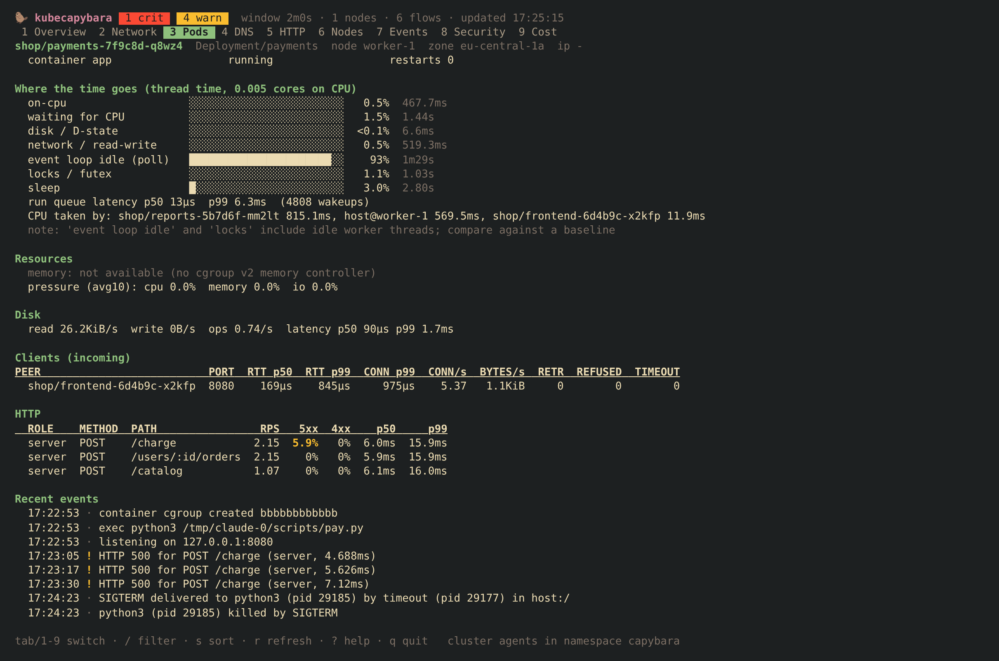
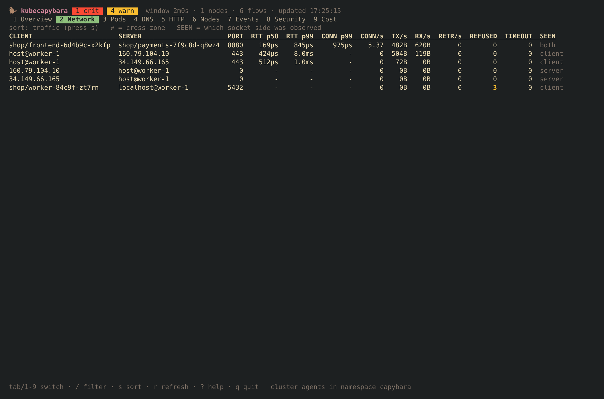
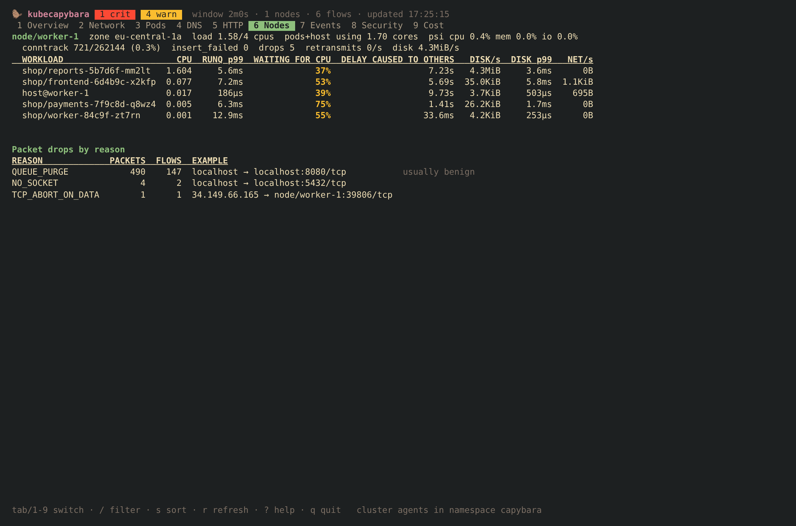

# kubecapybara 🦫

eBPF observability for Kubernetes that answers the questions you ask every day,
in your terminal, with no sidecars, no service mesh and no CNI lock-in.

```
kubectl capybara                       # interactive dashboard
kubectl capybara doctor                # what is wrong right now? (ranked, with fixes)
kubectl capybara pod payments-7f9c     # why is my pod slow?
kubectl capybara rollout payments      # did my deploy break anything?
kubectl capybara why-crash payments-7f9c
kubectl capybara startup payments-7f9c # why does it take 40s to become Ready?
```


<details><summary>More screens: pod detail, network, nodes, DNS</summary>






</details>

Regenerate with `go run ./hack/screenshot --from-file <bundle.json>` (renders
HTML frames; any headless browser turns them into PNGs).

## What it shows

| Question | Command | How it is measured |
|---|---|---|
| Is the network between A and B slow? | `edges` | Kernel smoothed TCP RTT, handshake latency, retransmits, resets, refused/timed-out connects, per pod pair (`tcp_probe`, `inet_sock_set_state`, `tcp_retransmit_skb` tracepoints) |
| Why is my pod slow? | `pod <pod>` | Per-pod thread time breakdown: on-CPU, **waiting for CPU**, disk (D-state), network/read-write, poll, locks (futex), sleep (`sched_switch`/`sched_wakeup` + syscall classification) |
| Who is my noisy neighbour? | `nodes` | Run queue delay attributed to the cgroup that occupied the CPU, disk and network usage per workload |
| DNS problems? | `dns` | Every DNS packet of every pod (cgroup skb hook): latency, NXDOMAIN/SERVFAIL, timeouts, **ndots:5 search-path waste**, per CoreDNS replica processing latency |
| Did my deploy break things? | `rollout <deploy>` | New vs. old ReplicaSet: 5xx, latency, RTT to dependencies, refused connections, DNS errors, CPU, memory, restarts, crashes |
| Why did it crash? | `why-crash <pod>` | Flight recorder: the last 2 minutes of execs, signals (and who sent them), exits, OOM kills, DNS and connect failures plus memory/CPU samples, frozen when the container's PID 1 dies |
| Why is startup slow? | `startup <pod>` | Timeline from pod creation → scheduling → container start → DNS lookups → connects → `listen()` → probes → Ready, with advice |
| What does it talk to? | `edges -f <name>` | Live dependency map including external hosts by name (learned from DNS answers) |
| HTTP errors/latency? | `http` | HTTP/1.x rate, errors, latency per route without sidecars (opt-in `--l7`) |
| Is anything shady going on? | `security` | Interactive `kubectl exec` sessions, shells spawned by app processes, undeclared listening ports, internet egress |
| What does cross-AZ traffic cost? | `cost` | Bytes per workload pair across zones × price |
| Who hammers the API server? | `doctor` | Connections/bytes from each workload to the `kubernetes` Service |
| Where is the CPU going? | `profile <pod>` | On-demand, cgroup-filtered CPU sampling with symbolization (kernel, ELF, Go pclntab); folded stacks for flame graphs |
| What NetworkPolicy do I need? | `netpol deploy/x` | Generates a policy allowing exactly the observed ingress/egress (+ DNS) |

The doctor runs ~25 rules over all of this: connection churn (no keep-alive),
ephemeral port exhaustion, conntrack table pressure and SNAT insert races,
kernel drop reasons (NetworkPolicy drops, full socket buffers, no route…), MTU
black holes, CPU throttling, memory near the limit and reclaim stalls, slow
disks, HTTP 5xx, crash loops. It also compares the current window to a
**baseline** (default: the previous hour) and reports regressions and new
dependencies.

## Architecture

```
 ┌───────────────────── every node (DaemonSet, privileged) ─────────────────────┐
 │  eBPF (CO-RE, tracepoints)                Go agent                            │
 │  net · drops · dns · sched · io ──maps──► 5s windows → 1m rollups (6h)        │
 │  proc · http · profile        ──ringbuf─► flight recorder, startup traces     │
 │                                           cgroup id → pod UID (cgroupfs)      │
 │                                           HTTP API :9876  /v1/snapshot        │
 │                                                           /v1/profile         │
 │                                                           /metrics (Prom.)    │
 └────────────────────────────────────────────▲─────────────────────────────────┘
                                              │ Kubernetes API server pod proxy
                                              │ (no port-forward, uses your RBAC)
                         ┌────────────────────┴───────────────────┐
                         │ kubectl-capybara                        │
                         │  merge nodes · resolve IPs → pods/svcs  │
                         │  doctor · rollout · startup · netpol    │
                         │  TUI (bubbletea) / text / JSON          │
                         └─────────────────────────────────────────┘
```

* **Agent** (`cmd/capybara-agent`): loads the eBPF programs, aggregates in
  kernel maps (log2 histograms, no per-packet events), drains them every 5s,
  keeps 15 minutes at full resolution and 6 hours of 1-minute rollups. It does
  not talk to the Kubernetes API: entities are cgroups mapped to pod UIDs.
* **CLI** (`cmd/kubectl-capybara`): discovers agents, fetches snapshots via the
  API server proxy, joins them with cluster metadata (pods, Services, nodes,
  zones, ReplicaSets) and renders. Works as a kubectl plugin when on `PATH`.
* Every collector is optional: if a kernel lacks a hook, that collector is
  disabled and reported in `kubectl capybara nodes` / doctor, the rest keeps
  working. The core needs **no kprobes**: it is built on tracepoints and BTF
  raw tracepoints, so it also runs on kernels without kprobes/ftrace.

## Install

With Helm (chart published to ghcr.io on every release tag):

```bash
helm install capybara oci://ghcr.io/galq5/charts/kubecapybara \
  -n capybara --create-namespace \
  --set rbac.viewers.groups={sre}            # who may run kubectl capybara
kubectl label ns capybara pod-security.kubernetes.io/enforce=privileged   # if PSA is enforced
```

Useful values (see `charts/kubecapybara/values.yaml`): `image.tag`,
`imagePullSecrets` (private registries), `agent.l7`, `agent.disable`,
`nodeSelector` (e.g. only workers), `metrics.serviceMonitor.enabled`.
Installed in another namespace? Pass `--agent-namespace <ns>` to the CLI.

Or with plain manifests:

```bash
kubectl apply -f deploy/kubernetes/capybara.yaml
```

The CLI (kubectl plugin): download `kubectl-capybara` from the GitHub release
(linux/darwin, amd64/arm64), put it on your `PATH`, or `make install-cli`.

```bash
kubectl capybara nodes     # which collectors run on each node
kubectl capybara doctor
```

Users of the CLI need read access to pods/services/nodes/replicasets/
deployments/endpointslices and `pods/proxy` in the agent namespace (the chart
binds them for `rbac.viewers`; the plain manifest has the roles to bind).

### Releasing

`git tag v0.1.0 && git push --tags` runs `.github/workflows/release.yml`: it
pushes the agent image to `ghcr.io/<owner>/kubecapybara-agent`, attaches CLI
binaries to a GitHub release and pushes the chart to
`oci://ghcr.io/<owner>/charts`. For a private repository the image is private:
create a pull secret (`kubectl create secret docker-registry ghcr
--docker-server=ghcr.io --docker-username=<user> --docker-password=<PAT with
read:packages>`) and set `imagePullSecrets[0].name=ghcr`, or make the package
public in its GitHub settings.

Requirements: Linux ≥ 5.8 with BTF (`/sys/kernel/btf/vmlinux`), cgroup v2,
x86_64 (arm64 needs an arm64 `vmlinux.h`, see Development). Drop reasons need
5.17+. Run `kubectl capybara nodes` to see which collectors are active per node.

## Using it

```bash
kubectl capybara                                # dashboard: tabs, filter with /, enter for pod details
kubectl capybara doctor -n shop                 # findings for one namespace
kubectl capybara edges --sort rtt -f payments   # slowest paths involving "payments"
kubectl capybara pod shop/payments-7f9c -w 5m   # 5 minute window
kubectl capybara rollout shop/payments --watch  # watch a rollout
kubectl capybara profile payments-7f9c -d 30s --folded out.folded
kubectl capybara netpol deploy/payments -n shop > policy.yaml
kubectl capybara snapshot --file incident.json  # share a self-contained bundle…
kubectl capybara --from-file incident.json doctor   # …and analyse it anywhere
kubectl capybara events --type oom,signal,exec_session
kubectl capybara doctor -o json                 # for scripts and CI
```

Talk to agents directly (e.g. on a single node, without the API server):

```bash
sudo ./bin/capybara-agent --listen 127.0.0.1:9876
./bin/kubectl-capybara --agent http://127.0.0.1:9876 --no-k8s doctor
```

Prometheus: each agent exposes `/metrics` (RTT/connect/DNS/HTTP/run queue
histograms, drops, conntrack, throttling…). Pod series carry a `pod_uid` label
to join with `kube_pod_info` from kube-state-metrics.

## Overhead and caveats

* All heavy lifting is in-kernel aggregation; user space reads maps every 5s.
  RTT is sampled at most every 100ms per socket. The scheduler collector runs on
  every context switch, which is the main cost on very busy nodes; disable it
  with `--disable sched` if needed.
* `--l7` hooks every `read`/`write` syscall on the node: keep it for clusters
  where that is acceptable. TLS traffic and HTTP/2 (gRPC) are not decoded.
* Connections to a ClusterIP are seen by the client as going to the Service
  (DNAT happens later) and by the server as coming from the client pod. Both
  views are shown; the `SEEN` column says which socket was observed.
* The thread time breakdown counts idle worker threads (e.g. thread pools
  parked in futex/epoll). Compare against a baseline rather than reading
  absolute shares.
* Buffered writeback I/O is attributed to the kernel flusher threads (host),
  not to the pod that dirtied the pages.

## Development

```
bpf/                 eBPF C sources (CO-RE) + vmlinux.h
internal/bpf/        bpf2go generated bindings and compiled objects (committed)
internal/agent/      collectors, windows/rollups, flight recorder, HTTP API, metrics
internal/cgroups/    cgroup id → pod/container resolution
internal/dnsparse/   DNS parsing and ndots heuristics
internal/symbolize/  kernel/ELF/Go symbolization for the profiler
internal/k8smeta/    cluster metadata (pods, services, nodes, zones, owners)
internal/client/     agent discovery (API server proxy, direct URLs, bundles)
internal/analysis/   name resolution, doctor rules, baseline, rollout, startup, netpol, cost
internal/render/     text reports shared by CLI and TUI
internal/tui/        bubbletea dashboard
cmd/                 capybara-agent, kubectl-capybara
deploy/kubernetes/   DaemonSet + RBAC (plain manifests)
charts/kubecapybara/ Helm chart
```

```bash
make test        # unit tests
make test-bpf    # load all eBPF objects into the running kernel (verifier check, needs root)
make generate    # recompile eBPF (needs clang + libbpf headers)
make vmlinux     # regenerate bpf/headers/vmlinux.h from the running kernel
```
