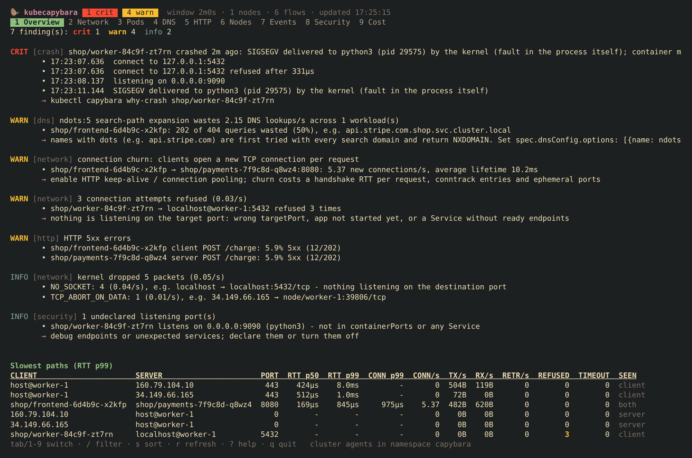
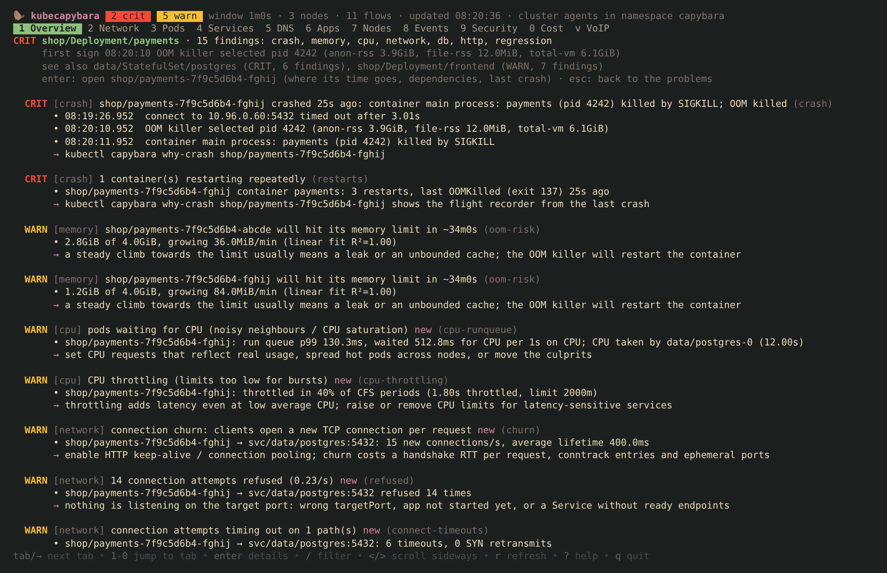
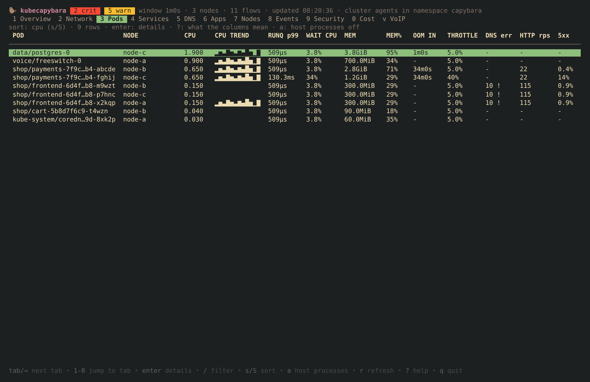
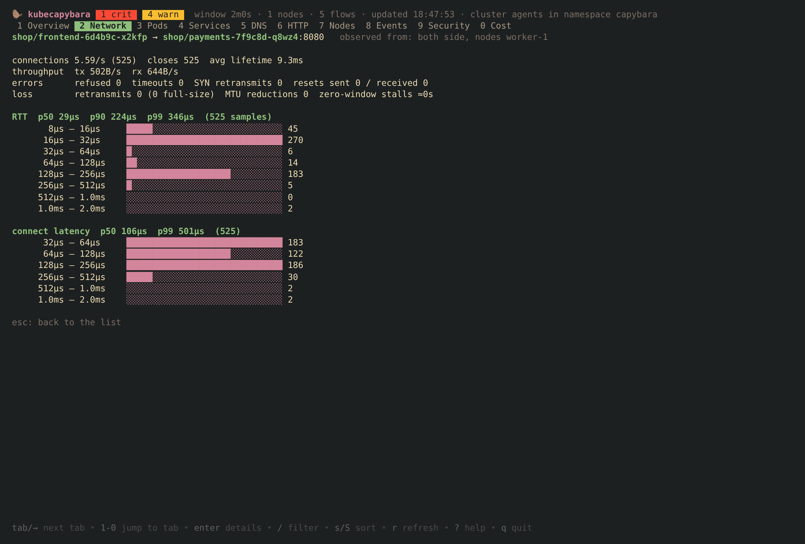
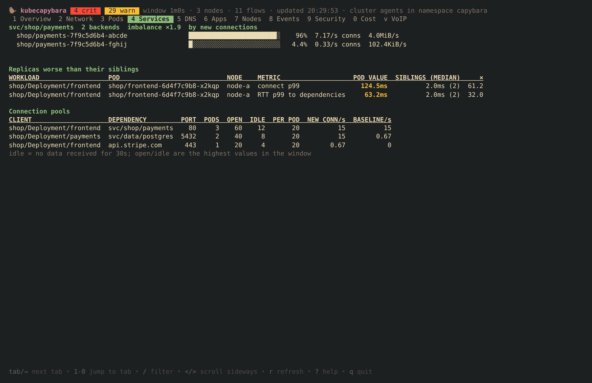
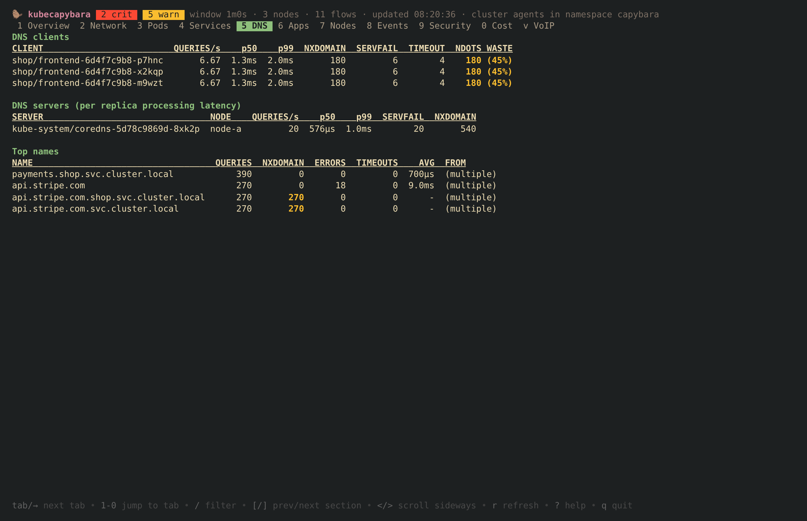
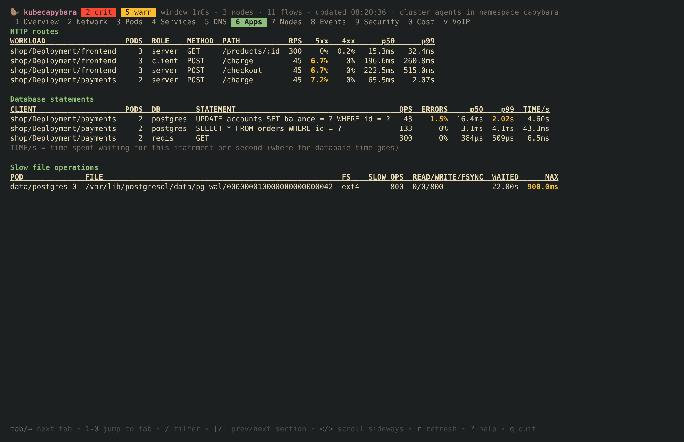
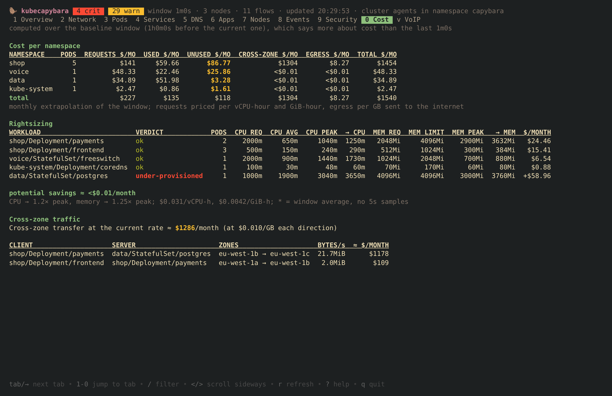
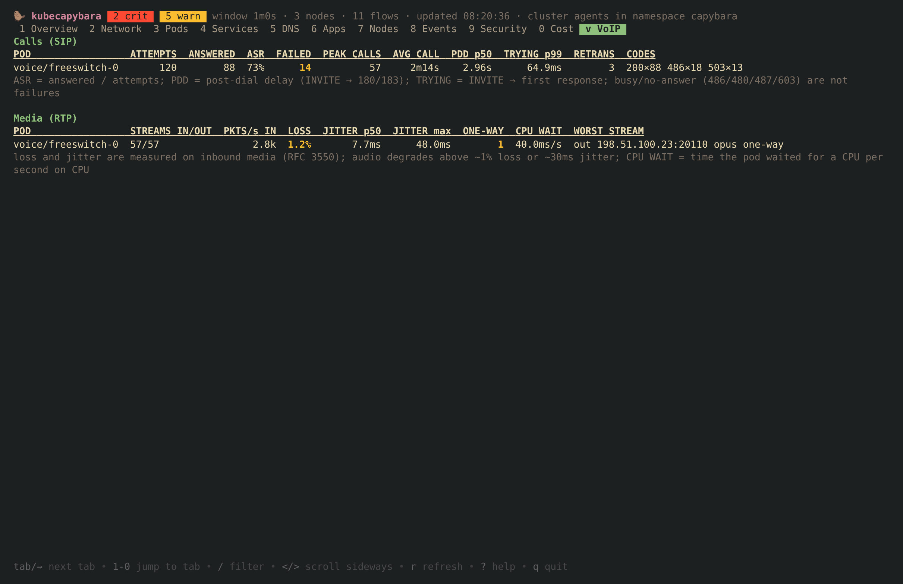

# kubecapybara 🦫

eBPF observability for Kubernetes that answers the questions you ask every day,
in your terminal, with no sidecars, no service mesh and no CNI lock-in.

```
kubectl capybara                       # interactive dashboard
kubectl capybara doctor                # what is wrong right now? (ranked, with fixes)
kubectl capybara pod payments-7f9c     # why is my pod slow?
kubectl capybara rollout payments      # did my deploy break anything?
kubectl capybara why-crash payments-7f9c
kubectl capybara startup payments-7f9c # why does it take 40s to become Ready?
```



<details><summary>More screens: one problem in full, pods, pod detail, network, connection detail, services, DNS, apps (HTTP, databases, files), nodes, cost, VoIP</summary>













</details>

The screens show the built-in demo cluster (`internal/demo`). Regenerate them
with `go run ./hack/screenshot --demo --out /tmp/screens` and
`node hack/screenshot/png.js /tmp/screens docs/screens` (needs Playwright), or
render your own cluster with `--from-file <bundle.json>`.

## What it shows

| Question | Command | How it is measured |
|---|---|---|
| Is the network between A and B slow? | `edges` | Kernel smoothed TCP RTT, connect latency (client side), retransmits, resets, refused/timed-out connects, per pod pair (`tcp_probe`, `inet_sock_set_state`, `tcp_retransmit_skb` tracepoints) |
| Why is my pod slow? | `pod <pod>` | Per-pod thread time breakdown: on-CPU, **waiting for CPU**, disk (D-state), network/read-write, poll, locks (futex), sleep (`sched_switch`/`sched_wakeup` + syscall classification) |
| Who is my noisy neighbour? | `nodes` | Run queue delay attributed to the cgroup that occupied the CPU, disk and network usage per workload |
| DNS problems? | `dns` | Every DNS packet of every pod (cgroup skb hook): latency, NXDOMAIN/SERVFAIL, timeouts, **ndots:5 search-path waste**, per CoreDNS replica processing latency |
| Did my deploy break things? | `rollout <deploy>` | New vs. old ReplicaSet: 5xx, latency, RTT to dependencies, refused connections, DNS errors, CPU, memory, restarts, crashes |
| Why did it crash? | `why-crash <pod>` | Flight recorder: the last 2 minutes of execs, signals (and who sent them), exits, OOM kills, DNS and connect failures plus memory/CPU samples, frozen when the container's PID 1 dies |
| Why is startup slow? | `startup <pod>` | Timeline from pod creation → scheduling → container start → DNS lookups → connects → `listen()` → probes → Ready, with advice |
| What does it talk to? | `edges -f <name>` | Live dependency map including external hosts by name (learned from DNS answers) |
| HTTP errors/latency? | `http` | HTTP/1.x rate, errors, latency per route and workload without sidecars (`--per-pod` for each replica; opt-in `--l7`) |
| Which queries are slow? | `db` | Plaintext Postgres (simple + extended protocol), MySQL, Redis, Cassandra (CQL v3-v5, matched by stream id, with error kinds such as ReadTimeout/Unavailable), Kafka (per API and client id), MongoDB (OP_MSG command + collection) and Memcached: rate, errors, p50/p99, time spent (opt-in `--l7`) |
| Which files is my pod waiting on? | `files` | Slow read/write/fsync on regular files with filesystem type (nfs, ext4, xfs…) (opt-in `--files`) |
| Is anything shady going on? | `security` | Interactive `kubectl exec` sessions, shells spawned by app processes, undeclared listening ports, internet egress |
| What does cross-AZ traffic cost? | `cost` | Bytes per workload pair across zones × price |
| Are my requests right? | `rightsize` | Measured CPU (5s samples) and memory peaks vs requests/limits per workload, recommendations and $/month |
| Will it OOM soon? | `oom` | Linear trend of pod memory towards its limit: "limit in ~12m" |
| Is a Service balanced? | `services` | Connection/byte share of every backend (long-lived connections pinning one pod) |
| Which node has a bad network? | `nodes` | Node-to-node RTT matrix with slow-node detection |
| What is the firewall blocking? | `security`, `doctor` | NetworkPolicy/iptables/tc drops attributed to pod pairs |
| Is the server keeping up? | `pod`, `doctor` | Accept queue overflows, zero-window stalls, receive queue drops per pod |
| Who hammers the API server? | `doctor` | Connections/bytes from each workload to the `kubernetes` Service |
| Are calls failing or choppy? | `voip` | SIP (FreeSWITCH, Asterisk, Kamailio, SBCs): attempts, answer ratio, 5xx/6xx and timeouts, post-dial delay, retransmissions, active calls; RTP: packet loss, jitter (RFC 3550, computed in-kernel per stream) and one-way audio, next to the pod's CPU wait (opt-in `--voip`) |
| Where is the CPU going? | `profile <pod>` | On-demand, cgroup-filtered CPU sampling with symbolization (kernel, ELF, Go pclntab); folded stacks for flame graphs |
| What NetworkPolicy do I need? | `netpol deploy/x` | Generates a policy allowing exactly the observed ingress/egress (+ DNS) |

The doctor runs ~25 rules over all of this: connection churn (no keep-alive),
ephemeral port exhaustion, conntrack table pressure and SNAT insert races,
kernel drop reasons (NetworkPolicy drops, full socket buffers, no route…), MTU
black holes, CPU throttling, memory near the limit and reclaim stalls, slow
disks, HTTP 5xx, crash loops. It also compares the current window to a
**baseline** (default: the previous hour) and reports regressions and new
dependencies.

One broken pod trips many rules at once, so the doctor does not hand you a
flat list: findings are grouped into **problems**, one per workload or node.

```
CRIT shop/Deployment/payments · 15 findings: crash, memory, cpu, network, db, http, regression
     first sign 08:16:28 OOM killer selected pid 4242 (anon-rss 3.9GiB, ...)
     see also data/StatefulSet/postgres (CRIT, 6 findings), shop/Deployment/frontend (WARN, 7 findings)
  CRIT [crash] shop/payments-7f9c5d6b4-fghij crashed 25s ago: ... killed by SIGKILL; OOM killed (crash)
       → kubectl capybara why-crash shop/payments-7f9c5d6b4-fghij
  WARN [cpu] pods waiting for CPU (noisy neighbours / CPU saturation) new (cpu-runqueue)
       • shop/payments-7f9c5d6b4-fghij: run queue p99 130.3ms ...; CPU taken by data/postgres-0 (12.00s)
  ...
```

* Within a problem the likely causes come first (crashes and memory, then CPU
  and disk, then dependencies) and the symptoms last (HTTP errors, outliers,
  regressions). "see also" lists the other problems its evidence points at:
  a dependency, a caller, a noisy neighbour.
* `new` marks a finding the baseline hour did not have for that workload,
  `ongoing` one it did.
* Commands in hints carry the real pod and workload names.
* A failing call seen on both ends is reported once, on the server, with the
  callers it fails for.
* Recommendations (cost, rightsizing, hygiene) are listed apart: nothing is
  broken there.

`kubectl capybara doctor --flat` prints the plain ranked list, `-o json` the
findings. To make the doctor quieter or stricter:

```bash
kubectl capybara doctor --list-rules                 # rule ids and thresholds
kubectl capybara doctor --mute internet-egress,undeclared-ports
kubectl capybara --doctor-config doctor.yaml         # or $CAPYBARA_DOCTOR_CONFIG
```

```yaml
# doctor.yaml
mute: [internet-egress]
thresholds:
  http-5xx-ratio: 0.05        # report routes above 5% 5xx instead of 1%
  cpu-throttled-ratio: 0.5
```

## Architecture

```
 ┌───────────────────── every node (DaemonSet, privileged) ─────────────────────┐
 │  eBPF (CO-RE, tracepoints)                Go agent                            │
 │  net · drops · dns · sched · io ──maps──► 5s windows → 1m rollups (6h)        │
 │  proc · http · profile        ──ringbuf─► flight recorder, startup traces     │
 │                                           cgroup id → pod UID (cgroupfs)      │
 │                                           HTTP API :9876  /v1/snapshot        │
 │                                                           /v1/profile         │
 │                                                           /metrics (Prom.)    │
 └────────────────────────────────────────────▲─────────────────────────────────┘
                                              │ Kubernetes API server pod proxy
                                              │ (no port-forward, uses your RBAC)
                         ┌────────────────────┴───────────────────┐
                         │ kubectl-capybara                        │
                         │  merge nodes · resolve IPs → pods/svcs  │
                         │  doctor · rollout · startup · netpol    │
                         │  TUI (bubbletea) / text / JSON          │
                         └─────────────────────────────────────────┘
```

* **Agent** (`cmd/capybara-agent`): loads the eBPF programs, aggregates in
  kernel maps (log2 histograms, no per-packet events), drains them every 5s,
  keeps 15 minutes at full resolution and 6 hours of 1-minute rollups. It does
  not talk to the Kubernetes API: entities are cgroups mapped to pod UIDs.
* **CLI** (`cmd/kubectl-capybara`): discovers agents, fetches snapshots via the
  API server proxy, joins them with cluster metadata (pods, Services, nodes,
  zones, ReplicaSets) and renders. Works as a kubectl plugin when on `PATH`.
* Every collector is optional: if a kernel lacks a hook, that collector is
  disabled and reported in `kubectl capybara nodes` / doctor, the rest keeps
  working. The core needs **no kprobes**: it is built on tracepoints and BTF
  raw tracepoints, so it also runs on kernels without kprobes/ftrace.

## Install

With Helm (chart published to ghcr.io on every release tag):

```bash
helm install capybara oci://ghcr.io/galq5/charts/kubecapybara \
  -n capybara --create-namespace \
  --set rbac.viewers.groups={sre}            # who may run kubectl capybara
kubectl label ns capybara pod-security.kubernetes.io/enforce=privileged   # if PSA is enforced
```

Useful values (see `charts/kubecapybara/values.yaml`): `image.tag`,
`imagePullSecrets` (private registries), `agent.l7`, `agent.disable`,
`nodeSelector` (e.g. only workers), `metrics.serviceMonitor.enabled`.
Installed in another namespace? Pass `--agent-namespace <ns>` to the CLI.

Or with plain manifests:

```bash
kubectl apply -f deploy/kubernetes/capybara.yaml
kubectl -n capybara create secret generic capybara-agent-token \
  --from-literal=token="$(head -c 32 /dev/urandom | base64 | tr -dc A-Za-z0-9)"
kubectl -n capybara rollout restart ds/capybara-agent
```

**API authentication.** The agent API exposes process command lines (secret-
looking arguments such as `--password=` or `API_KEY=` are masked) and traffic
data, so `/v1/*` requires the token from the `capybara-agent-token` Secret in
the `X-Capybara-Token` header (`/healthz` and `/metrics` stay open). The chart
generates it; the CLI reads it with your own RBAC, so being allowed to `get`
that Secret is what grants access. With `--agent URL`, pass `--agent-token`.

The CLI (kubectl plugin): download `kubectl-capybara` from the GitHub release
(linux/darwin, amd64/arm64), put it on your `PATH`, or `make install-cli`.

```bash
kubectl capybara nodes     # which collectors run on each node
kubectl capybara doctor
```

Users of the CLI need read access to pods/services/nodes/replicasets/
deployments/endpointslices and `pods/proxy` in the agent namespace (the chart
binds them for `rbac.viewers`; the plain manifest has the roles to bind).

### VoIP (FreeSWITCH, Asterisk, Kamailio)

`--set agent.voip.enabled=true` (agent `--voip`) watches plain SIP on
`agent.voip.sipPorts` (default 5060, 5080) and RTP on the local port range
`agent.voip.rtpPorts` (default 16384-32768, FreeSWITCH's defaults):

```bash
kubectl capybara voip -n voice        # illustrative output
Calls (SIP)
POD                  ATTEMPTS  ANSWERED  ASR  FAILED  PEAK CALLS  AVG CALL  PDD p50  TRYING p99  RETRANS  CODES
voice/freeswitch-0        412       301  73%      38          57     2m14s     2.1s       3.2ms        9  200×301 486×52 503×31 408×7
Media (RTP)
POD                  STREAMS IN/OUT  PKTS/s IN  LOSS  JITTER p50  JITTER max  ONE-WAY  CPU WAIT  WORST STREAM
voice/freeswitch-0   57/57              2.85k  2.4%       6.1ms      48.0ms        1  95ms/s   in 203.0.113.7:31544 PCMA loss 9.8%
```

* SIP is parsed from the first 1 KiB of each packet (UDP, and TCP when one
  message fits a segment). Transactions are matched per Call-ID/CSeq and role
  (`uac` = the pod sent the request, `uas` = it received it). Busy/no answer
  (486/480/487/603) are not counted as failures. TLS signalling is not visible.
* RTP is never copied to user space: the kernel keeps per-stream sequence
  tracking (loss, reordering) and interarrival jitter, using the clock rate
  of the payload type learned from SDP (`a=rtpmap`, e.g. Opus 48 kHz). Loss and
  jitter are measured on the receiving side; SRTP works too (the RTP header
  is not encrypted).
* Doctor rules: `sip-failures`, `sip-slow-setup`, `sip-retransmissions`,
  `rtp-loss`, `rtp-jitter` (mentions CPU starvation when the pod also waits
  for CPU) and `rtp-one-way` (a stream with no media coming back for 10s+).
* Prometheus: `capybara_sip_requests_total`, `capybara_sip_responses_total{code}`,
  `capybara_sip_post_dial_delay_seconds`, `capybara_sip_calls_active`,
  `capybara_rtp_packets_lost_total`, `capybara_rtp_jitter_seconds`,
  `capybara_rtp_one_way_streams`...

### Large clusters: the hub

By default the CLI asks every agent through the API server pod proxy and
lists all pods itself. That is the fastest path on small and medium clusters
and has no extra component. From roughly 100–200 nodes it means a lot of
proxied requests per refresh, so the chart has an optional aggregator:

```bash
helm upgrade capybara ... --set hub.enabled=true
kubectl capybara                  # finds the hub automatically (--hub=off bypasses it)
kubectl capybara -n shop          # the hub filters to one namespace before sending
kubectl capybara --top 200        # only the 200 busiest + 200 most failing connections/pods
kubectl capybara --top 0          # everything, even when the hub sets hub.defaultTop
kubectl capybara --refresh 15s    # slower dashboard refresh
```

Without `--top` the hub's `hub.defaultTop` applies (0, everything, by
default); the controller always evaluates everything unless given `--top`.

`capybara-hub` (a Deployment, same image):

* builds cluster metadata from **informers** (one watch, no repeated LISTs of
  every pod) and discovers agents the same way;
* fetches agents **directly by pod IP** with bounded concurrency, and merges
  identical concurrent requests: ten people running the dashboard cost one
  fan-out per interval;
* **scopes** responses (`-n`, `--top`) and prunes the metadata to the pods and
  Services the data refers to, and gzips them;
* forwards `profile` and `counters` to the right node's agent.

A dashboard refresh becomes one request through the API server instead of
one per node. With the hub enabled the controller reads from it too. CLI users
need `get` on `services/proxy` in the agent namespace (bound for
`rbac.viewers`). Hub metrics: `capybara_hub_agents`,
`capybara_hub_fanout_last_seconds`, `capybara_hub_cache_hits_total`,
`capybara_hub_agent_errors_total`.

### Controller: findings as Kubernetes objects, Slack and webhooks

`--set controller.enabled=true` adds a single-replica Deployment
(`capybara-controller`, same image) that runs the doctor every minute over the
last 5 minutes and keeps one `CapyFinding` object per rule and workload:

```bash
kubectl get capyfindings -A          # short name: capyf
NAMESPACE  NAME                     SEVERITY  CATEGORY  STATE     TITLE                                   LAST-SEEN  AGE
shop       cpu-throttling-1c9e2a7b  CRIT      cpu       Active    shop/api throttled in 62% of CFS periods 20s        14m
shop       slo-burn-5d01f3c2        WARN      slo       Resolved  checkout-latency burning budget 6.1x     12m        2h
kubectl get capyf -n shop cpu-throttling-1c9e2a7b -o yaml   # details, hint, firstSeen, occurrences
```

A finding is `Active` while the doctor reports it, becomes `Resolved` after
`controller.resolveAfter` (10m) without it and is deleted after
`controller.keepResolved` (1h). Findings about a pod live in the pod's
namespace, so namespace RBAC applies to who can see them; cluster-wide ones go
to the release namespace. Only `minSeverity` (default `warn`) and above are
stored.

The Helm release name and namespace identify which findings a controller owns.
Standalone controllers sharing a cluster can set distinct, stable `--instance`
values. On upgrade, the controller creates new findings under that identity.
Findings from older versions lack the ownership label and need manual cleanup.

Notifications are sent on *firing* and *resolved*:

```bash
kubectl -n capybara create secret generic capybara-hooks \
  --from-literal=slack-webhook-url=https://hooks.slack.com/services/... \
  --from-literal=webhook-url=https://alerts.example.com/capybara   # optional, JSON body
helm upgrade capybara ... --set controller.enabled=true \
  --set controller.notifications.existingSecret=capybara-hooks --set controller.clusterName=prod
```

The generic webhook receives `{"event":"firing","namespace":...,"name":...,
"rule":...,"severity":"CRIT","title":...,"details":[...],"hint":...}`; the
Slack format also works with Mattermost. SLOs set in `controller.slos` (same
format as `--slo-file`) get burn-rate findings. `controller.doctor` mutes
rules and overrides thresholds (same format as `--doctor-config`), so a rule
you do not care about creates no objects and no notifications:

```yaml
controller:
  doctor:
    mute: [internet-egress, undeclared-ports]
    thresholds: {http-5xx-ratio: 0.05}
```

### Releasing

`git tag v0.1.0 && git push --tags` runs `.github/workflows/release.yml`: it
pushes the agent image to `ghcr.io/<owner>/kubecapybara-agent` (it also
contains `/capybara-controller` and `/capybara-hub`), attaches CLI, controller and hub binaries to a GitHub release and pushes the chart to
`oci://ghcr.io/<owner>/charts`. For a private repository the image is private:
create a pull secret (`kubectl create secret docker-registry ghcr
--docker-server=ghcr.io --docker-username=<user> --docker-password=<PAT with
read:packages>`) and set `imagePullSecrets[0].name=ghcr`, or make the package
public in its GitHub settings.

Requirements: Linux ≥ 5.8 with BTF (`/sys/kernel/btf/vmlinux`), cgroup v2,
x86_64 (arm64 needs an arm64 `vmlinux.h`, see Development). Drop reasons need
5.17+. Run `kubectl capybara nodes` to see which collectors are active per node.

## Using it

The `incident` timeline requires live agents. Saved bundles contain aggregate
windows and can be replayed with commands such as `doctor`.

```bash
kubectl capybara                                # dashboard (see below)
kubectl capybara doctor -n shop                 # findings for one namespace
kubectl capybara edges --sort rtt -f payments   # slowest paths involving "payments"
kubectl capybara pod shop/payments-7f9c -w 5m   # 5 minute window
kubectl capybara rollout shop/payments --watch  # watch a rollout
kubectl capybara profile payments-7f9c -d 30s --folded out.folded
kubectl capybara netpol deploy/payments -n shop > policy.yaml
kubectl capybara snapshot --file incident.json  # share a self-contained bundle…
kubectl capybara --from-file incident.json doctor   # …and analyse it anywhere
kubectl capybara events --type oom,signal,exec_session
kubectl capybara doctor -o json                 # for scripts and CI
```

### The dashboard

`kubectl capybara` opens the dashboard. It fits terminals from 80×24 up:
on narrow ones the tables keep their error columns and drop volumes first.

| Tab | Key | What it answers |
|---|---|---|
| Overview | `1` | What is wrong right now: the doctor's problems, worst first. `↑`/`↓` select one, `enter` opens it with all its evidence and what to do, `enter` again opens the pod it is about, `esc` goes back |
| Network | `2` | Every connection between pods, Services and the outside: latency, errors, volume. `enter` opens one connection |
| Pods | `3` | CPU, waiting for CPU, memory, time to OOM, throttling, errors per pod (`a` adds host processes). `enter` opens a pod: last crash, where its time goes, dependencies, HTTP, database, startup |
| Services | `4` | Load balance over backends, replicas worse than their siblings, connection pools |
| DNS | `5` | Clients, DNS server replicas, most queried and failing names |
| Apps | `6` | What applications wait on: HTTP routes and database statements per workload, slow files |
| Nodes | `7` | One line per node, node-to-node latency, workloads of the busiest nodes, packet drops, control plane |
| Events | `8` | Flight recorder, newest first |
| Security | `9` | Exec sessions, shells, undeclared ports, blocked traffic, internet egress |
| Cost | `0` | Cost per namespace, rightsizing and cross-zone traffic over the baseline window |
| VoIP | `v` | SIP calls and RTP quality; only shown when there is voice traffic |

`/` filters every tab, `s`/`S` change the sort order of the Network and Pods
tables, `[`/`]` jump between the sections of a long tab, `<`/`>` scroll
sideways, `?` lists all keys and explains the columns of the table on screen.

Talk to agents directly (e.g. on a single node, without the API server):

```bash
sudo ./bin/capybara-agent --listen 127.0.0.1:9876
./bin/kubectl-capybara --agent http://127.0.0.1:9876 --no-k8s doctor
```

Prometheus: each agent exposes `/metrics` (RTT/connect/DNS/HTTP/run queue
histograms, drops, conntrack, throttling…). Pod series carry a `pod_uid` label
to join with `kube_pod_info` from kube-state-metrics.

## Overhead and caveats

* All heavy lifting is in-kernel aggregation; user space reads maps every 5s.
  RTT is sampled at most every 100ms per socket. The scheduler collector runs on
  every context switch, which is the main cost on very busy nodes; disable it
  with `--disable sched` if needed.
* `--l7` hooks every `read`/`write` syscall on the node: keep it for clusters
  where that is acceptable. TLS traffic and HTTP/2 (gRPC) are not decoded.
* Connections to a ClusterIP are seen by the client as going to the Service
  (DNAT happens later) and by the server as coming from the client pod. Both
  views are shown; the `SEEN` column says which socket was observed.
* The thread time breakdown counts idle worker threads (e.g. thread pools
  parked in futex/epoll). Compare against a baseline rather than reading
  absolute shares.
* Buffered writeback I/O is attributed to the kernel flusher threads (host),
  not to the pod that dirtied the pages.

## Development

```
bpf/                 eBPF C sources (CO-RE) + vmlinux.h
internal/bpf/        bpf2go generated bindings and compiled objects (committed)
internal/agent/      collectors, windows/rollups, flight recorder, HTTP API, metrics
internal/cgroups/    cgroup id → pod/container resolution
internal/dnsparse/   DNS parsing and ndots heuristics
internal/sipparse/   SIP and SDP parsing
internal/symbolize/  kernel/ELF/Go symbolization for the profiler
internal/k8smeta/    cluster metadata (pods, services, nodes, zones, owners)
internal/client/     agent discovery (API server proxy, hub, direct URLs, bundles)
internal/analysis/   name resolution, doctor rules, baseline, rollout, startup, netpol, cost
internal/render/     text reports shared by CLI and TUI
internal/tui/        bubbletea dashboard
internal/demo/       synthetic cluster for the dashboard tests and the screenshots
internal/hub/        capybara-hub: informers, agent fan-out, scoping
internal/controller/ capybara-controller: CapyFinding objects, notifications
cmd/                 capybara-agent, kubectl-capybara, capybara-hub, capybara-controller
deploy/kubernetes/   DaemonSet + RBAC (plain manifests)
charts/kubecapybara/ Helm chart
```

```bash
make test        # go vet + unit tests
make lint        # gofmt + go vet
make test-bpf    # as root: load all eBPF objects into the running kernel (verifier check) and run the live tests
make generate    # recompile eBPF (needs clang + libbpf headers)
make vmlinux     # regenerate bpf/headers/vmlinux.h from the running kernel
```

Shell completion: `kubectl-capybara completion bash|zsh|fish|powershell`.

## Contributing, security, license

See [CONTRIBUTING.md](CONTRIBUTING.md) for how to build, test and change the
eBPF programs, and [SECURITY.md](SECURITY.md) for how to report a
vulnerability and what the agent exposes.

kubecapybara is licensed under the [Apache License 2.0](LICENSE). The eBPF
programs in `bpf/` are dual licensed `GPL-2.0-only OR BSD-2-Clause` (the kernel
requires a GPL-compatible license for the helpers they use).
